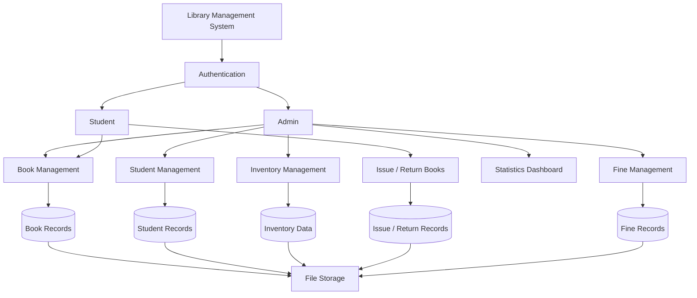
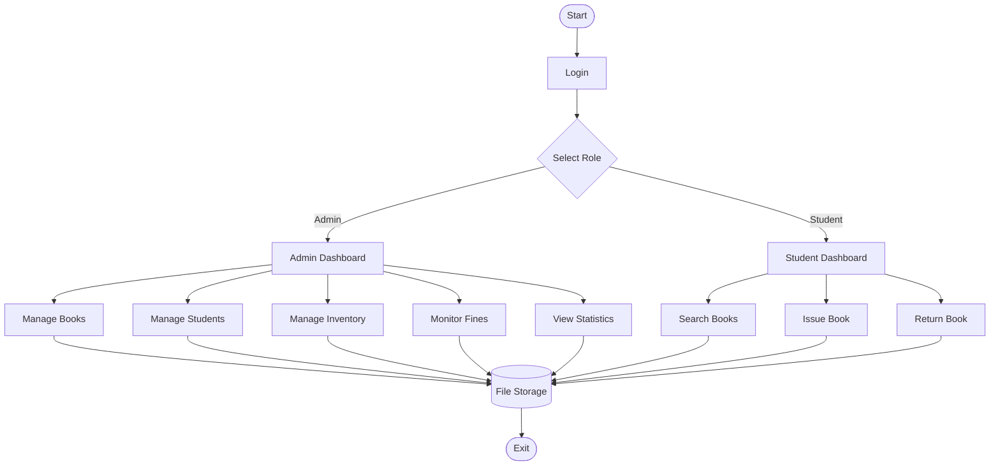

# 📚 Library Management System

A **console-based Library Management System** developed in **C** for the **Software Development Laboratory**. The system automates common library operations including book management, student management, issue/return transactions, inventory tracking, authentication, fine calculation, and statistical analysis.

---

## 👥 Team Members

| S. No. | Name            | Roll Number |
| :----: | --------------- | :---------: |
|    1   | **Yanik Kumar** |  2601020023 |
|    2   | **Ayush Kumar** |  2601020018 |
|    3   | **Arav Singh**  |  2601020003 |
|    4   | **Nehal Gupta** |  2601020025 |

### Project Information

* **Project Title:** Library Management System
* **Course:** Software Development Laboratory
* **Branch:** Electronics and Communication Engineering (ECE)
* **Programming Language:** C
* **Application Type:** Console-Based Application

---

## 📖 Project Description

The **Library Management System** is a menu-driven console application developed using the **C programming language** to efficiently manage library operations.

The system provides separate access for **Administrators** and **Students**, enabling secure management of books, student records, transactions, inventory, and fines.

Along with basic library operations, the project incorporates advanced features such as:

* 🔐 Role-based authentication
* 📚 Category-based book organization
* 📦 Inventory tracking
* 💰 Automatic fine calculation
* ⚠️ Pending fine monitoring
* 📊 Library statistics dashboard
* 👨‍🎓 Student record management
* 🔄 Book issue and return tracking

The system uses **file handling** for persistent data storage, ensuring that records are retained even after the application is closed.

---

# ✨ Key Features

### 🔐 Authentication

* Admin login
* Student login
* Role-based access control

### 📚 Book Management

* Add books
* Delete books
* Search books
* Categorize books
* Issue books
* Return books

### 👨‍🎓 Student Management

* Maintain student records
* Track issued books
* Monitor student fines

### 📦 Inventory Management

* Track total copies
* Track available copies
* Track issued copies
* Automatically update inventory after issue/return

### 💰 Fine Management

* Calculate fines
* Track pending fines
* Monitor unpaid fines

### 📊 Statistics Dashboard

The administrator can view important library statistics such as:

* Total Books
* Available Books
* Issued Books
* Total Students
* Students with Pending Fines

---

# 🛠️ Software Requirement Specification

## Functional Requirements

### 👨‍💼 Admin Functions

The administrator can:

* Add books
* Delete books
* Manage inventory
* View student records
* Monitor pending fines
* Access the statistics dashboard

### 👨‍🎓 Student Functions

Students can:

* Log in using authentication
* Search for books
* Issue books
* Return books
* View relevant library information

### ⚙️ System Functions

The system is responsible for:

* Maintaining book records
* Storing student information
* Calculating fines
* Tracking inventory status
* Maintaining issue and return records
* Generating library statistics

---

## 🔒 Non-Functional Requirements

| Requirement         | Description                                      |
| ------------------- | ------------------------------------------------ |
| **User-Friendly**   | Menu-driven and easy-to-use interface            |
| **Security**        | Authentication-based access                      |
| **Performance**     | Fast record searching and retrieval              |
| **Reliability**     | File-based persistent data storage               |
| **Maintainability** | Modular and organized implementation             |
| **Scalability**     | Can be extended with additional library features |

---

# 💻 System Requirements

## Hardware Requirements

| Component     | Requirement       |
| ------------- | ----------------- |
| **Processor** | Intel i3 or above |
| **RAM**       | 4 GB minimum      |
| **Storage**   | 100 MB free space |

## Software Requirements

| Component                | Requirement                  |
| ------------------------ | ---------------------------- |
| **Operating System**     | Windows / Linux              |
| **Programming Language** | C                            |
| **Compiler**             | GCC / Code::Blocks / Turbo C |

---

# 🧩 Major Modules

## 1. 🔐 Authentication Module

Provides secure, role-based login for:

* Administrator
* Student

The authenticated user's role determines which operations are accessible.

---

## 2. 📚 Book Management Module

Responsible for managing library books.

### Operations

```text
Add Book
   ↓
Delete Book
   ↓
Search Book
   ↓
Issue Book
   ↓
Return Book
```

Books can also be organized into different categories for easier management and searching.

---

## 3. 👨‍🎓 Student Management Module

Maintains student-related information and tracks their library activities.

It can store information such as:

* Student ID
* Student Name
* Contact/other relevant details
* Issued books
* Pending fines

---

## 4. 📦 Inventory Management Module

Tracks the availability of books in the library.

The system maintains information about:

```text
Total Copies
     │
     ├── Available Copies
     │
     └── Issued Copies
```

When a book is issued, the available inventory decreases.

When a book is returned, the available inventory increases.

---

## 5. 💰 Fine Management Module

The system calculates fines based on applicable return conditions.

It maintains:

* Fine amount
* Pending fines
* Student-wise fine information

This allows administrators to monitor outstanding payments.

---

## 6. 📊 Statistics Dashboard

The dashboard provides a quick overview of the library.

### Example Statistics

```text
╔══════════════════════════════╗
║      LIBRARY STATISTICS      ║
╠══════════════════════════════╣
║ Total Books       : XXXX     ║
║ Available Books   : XXXX     ║
║ Issued Books      : XXXX     ║
║ Total Students    : XXXX     ║
║ Pending Fines     : XXXX     ║
╚══════════════════════════════╝
```

---

# 🏗️ System Architecture

The overall architecture of the system can be represented as:



---

# 🔄 Application Workflow



---

# 🧱 Mapping of C Programming Concepts

The project demonstrates several fundamental C programming concepts required for the Software Development Laboratory.

## 1. 🔀 Control Flow

Control-flow statements are used throughout the application for decision-making and menu navigation.

### Concepts Used

* `if`
* `if-else`
* `switch-case`
* `for`
* `while`
* `do-while`

### Applications

Control flow is used for:

* User authentication
* Menu navigation
* Searching books
* Issuing books
* Returning books
* Checking availability
* Fine calculation
* Administrative operations

---

## 2. 📋 Arrays

Arrays are used to store collections of data within the system.

Examples include:

```c
Book books[MAX_BOOKS];
Student students[MAX_STUDENTS];
```

They can be used to maintain multiple book and student records during program execution.

---

## 3. 🏗️ Structures

Structures allow related information to be grouped into a single data type.

### Example

```c
struct Book {
    int id;
    char title[100];
    char author[100];
    char category[50];
    int totalCopies;
    int availableCopies;
};
```

Similarly, structures can be created for:

* Books
* Students
* Issue records
* Fine records

This makes the data more organized and easier to manage.

---

## 4. 📁 File Handling

File handling provides **persistent storage** for the application.

Instead of losing all information when the program terminates, important records can be stored in files.

### Stored Information

```text
📚 Book Records
👨‍🎓 Student Records
📦 Inventory Data
🔄 Issue & Return Records
💰 Pending Fine Information
```

Typical C file-handling functions include:

```c
fopen()
fclose()
fread()
fwrite()
fprintf()
fscanf()
```

This allows data to remain available between different executions of the program.

---

# 📂 Suggested Project Structure

```text
Library-Management-System/
│
├── README.md
├── main.c
│
├── data/
│   ├── books.dat
│   ├── students.dat
│   ├── issues.dat
│   └── fines.dat
│
├── src/
│   ├── authentication.c
│   ├── books.c
│   ├── students.c
│   ├── inventory.c
│   └── fines.c
│
└── docs/
    └── project-synopsis.pdf
```

> The actual project structure may differ depending on the implementation.

---

# 🚀 How to Run

## Using GCC

### 1. Clone the repository

```bash
git clone https://github.com/USERNAME/Library-Management-System.git
```

### 2. Navigate to the project directory

```bash
cd Library-Management-System
```

### 3. Compile the program

```bash
gcc main.c -o library
```

### 4. Run the application

### Windows

```bash
library.exe
```

### Linux/macOS

```bash
./library
```

---

# 🖥️ Example Menu

```text
========================================
       LIBRARY MANAGEMENT SYSTEM
========================================

1. Admin Login
2. Student Login
3. Exit

Enter your choice:
```

### Admin Dashboard

```text
========================================
          ADMIN DASHBOARD
========================================

1. Add Book
2. Delete Book
3. Search Book
4. Manage Students
5. Manage Inventory
6. Pending Fines
7. Statistics Dashboard
8. Logout
```

### Student Dashboard

```text
========================================
         STUDENT DASHBOARD
========================================

1. Search Book
2. Issue Book
3. Return Book
4. View Fines
5. Logout
```

---

# 🎯 Project Objectives

The major objectives of this project are:

1. To automate basic library management operations.
2. To provide separate functionality for administrators and students.
3. To maintain organized book and student records.
4. To track book inventory efficiently.
5. To automate fine calculation and monitoring.
6. To demonstrate the practical implementation of fundamental C programming concepts.
7. To implement persistent storage using file handling.
8. To provide a structured and scalable software solution.

---

# 🌟 Highlights

This project goes beyond a basic library management program by combining multiple concepts into a single system:

```text
             ┌─────────────────────┐
             │ Library Management  │
             │       System        │
             └──────────┬──────────┘
                        │
       ┌────────────────┼────────────────┐
       │                │                │
   Authentication   Management       Analytics
       │                │                │
       ▼                ▼                ▼
  Admin / Student   Books / Students   Statistics
                        │
                 ┌──────┼──────┐
                 ▼      ▼      ▼
             Inventory Issue  Fines
                        │
                        ▼
                  File Storage
```

---

# 📌 Conclusion

The **Library Management System** is a menu-driven C application designed to automate and organize essential library operations.

The project demonstrates the practical application of:

* Control flow statements
* Arrays
* Structures
* Functions
* File handling
* Authentication
* Data management

By integrating **book management, student management, inventory tracking, fine calculation, authentication, and statistical analysis**, the system provides an organized approach to managing library resources.

The project also provides a strong foundation for future enhancements such as a graphical user interface, database integration, barcode/QR-based book tracking, advanced search, online authentication, and cloud-based data management.

---

## 👨‍💻 Developed By

**Yanik Kumar** · **Ayush Kumar** · **Arav Singh** · **Nehal Gupta**

**Software Development Laboratory — ECE**
