# 📚 Library Management System

A **menu-driven, console-based Library Management System** written in **C** for the **Software Development Laboratory** (B.Tech ECE, First Year). It handles books, students, issue/return, inventory, fines and library statistics, and saves everything in files so data is not lost when the program closes.

---

## 👥 Team Members

| S. No. | Name            | Roll Number |
| :----: | --------------- | :---------: |
|   1    | **Yanik Kumar** | 2601020023  |
|   2    | **Ayush Kumar** | 2601020018  |
|   3    | **Arav Singh**  | 2601020003  |
|   4    | **Nehal Gupta** | 2601020025  |

---

## 📖 About the Project

The library does its daily work on a computer instead of on paper. There are two types of users, **Admin** and **Student**, and each one sees only the options meant for them.

---

## ✨ Functions of the Project

| Module | What it does |
| ------ | ------------ |
| 🔐 **Authentication** | Admin and Student log in separately. The role decides which menu the user gets. |
| 📚 **Book Management** | Admin adds and deletes books. Books are kept in categories. Students search, issue and return books. |
| 👨‍🎓 **Student Management** | Stores student ID, name, issued books and pending fines so the admin can view each student's record. |
| 📦 **Inventory Management** | Keeps total, available and issued copies. Issuing a book reduces available copies; returning it increases them. |
| 💰 **Fine Management** | Calculates fine on late returns and tracks pending (unpaid) fines for every student. |
| 📊 **Statistics Dashboard** | Shows total books, available books, issued books, total students and students with pending fines. |

### 👨‍💼 Admin can
Add books · Delete books · Manage inventory · View student records · Monitor pending fines · View statistics

### 👨‍🎓 Student can
Log in · Search books · Issue books · Return books · View fines

---

## 🏗️ System Architecture

```mermaid
flowchart TD
    A[Library Management System] --> B[Authentication]

    B --> C[Admin]
    B --> D[Student]

    C --> E[Book Management]
    C --> F[Student Management]
    C --> G[Inventory Management]
    C --> H[Fine Management]
    C --> I[Statistics Dashboard]

    D --> E
    D --> J[Issue / Return Books]

    E --> K[(Book Records)]
    F --> L[(Student Records)]
    G --> M[(Inventory Data)]
    J --> N[(Issue / Return Records)]
    H --> O[(Fine Records)]

    K --> P[File Storage]
    L --> P
    M --> P
    N --> P
    O --> P
```



---

## 🔄 Application Workflow


---

## 📊 Statistics Dashboard (Sample Output)

```text
╔══════════════════════════════╗
║      LIBRARY STATISTICS      ║
╠══════════════════════════════╣
║ Total Books       : XXXX     ║
║ Available Books   : XXXX     ║
║ Issued Books      : XXXX     ║
║ Total Students    : XXXX     ║
║ Pending Fines     : XXXX     ║
╚══════════════════════════════╝
```

---

## 🧱 C Concepts Used

* **Control flow:** `if-else`, `switch-case` and loops for menus, login, search, issue/return and fine calculation.
* **Arrays and structures:** `struct` groups book, student, issue and fine details; arrays hold many records at once.
* **File handling:** `fopen`, `fclose`, `fread`, `fwrite`, `fprintf`, `fscanf` store records permanently.
* **Functions:** each module is written as separate functions to keep the code organised.

---

## 💻 Requirements

| Component | Requirement |
| --------- | ----------- |
| **Hardware** | Intel i3 or above, 4 GB RAM, 100 MB free space |
| **Software** | Windows / Linux, GCC / Code::Blocks / Turbo C |

---

## 🚀 How to Run

```bash
git clone https://github.com/USERNAME/Library-Management-System.git
cd Library-Management-System
gcc main.c -o library
./library          # Linux / macOS
library.exe        # Windows
```

---

## 📌 Conclusion

The system automates the main library tasks and shows how first-year C topics (control flow, arrays, structures, functions and file handling) can be combined in one practical project.

**Future scope:** graphical interface, database integration, barcode/QR book tracking and online login.

---

## 👨‍💻 Developed By

**Yanik Kumar** · **Ayush Kumar** · **Arav Singh** · **Nehal Gupta**
